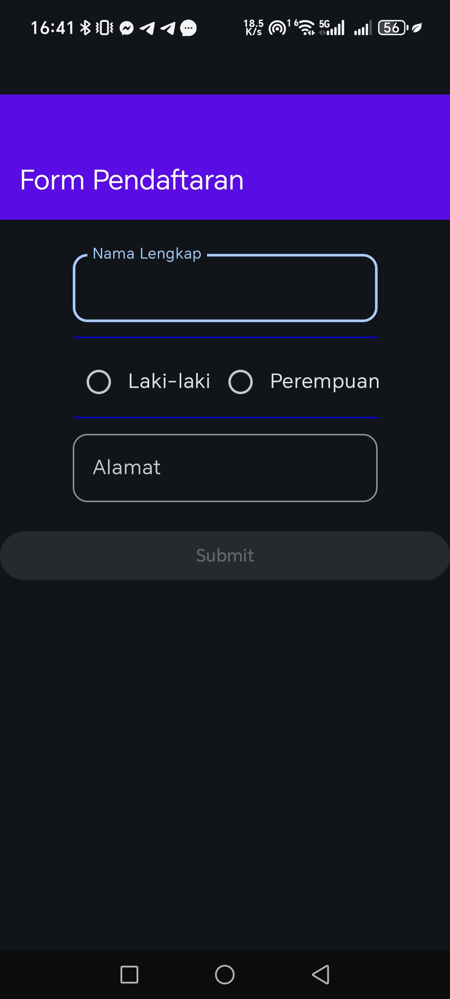
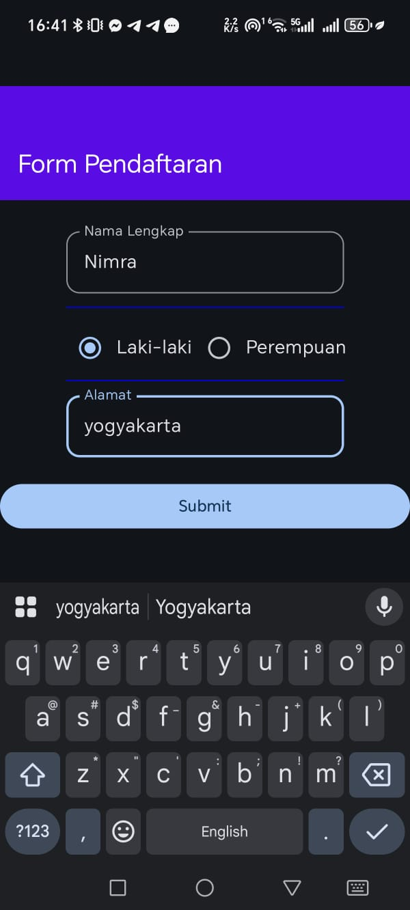
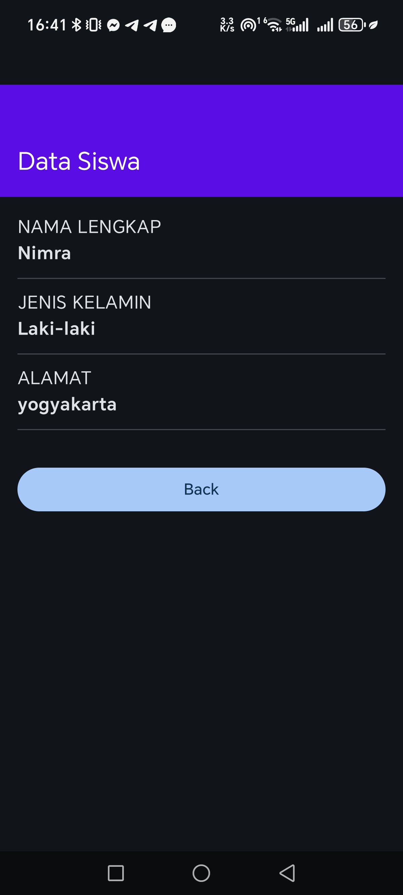

# QuestMVVM_0146

This Android application implements a basic student registration form demonstrating the **MVVM (Model-View-ViewModel)** architecture pattern using **Jetpack Compose**. It features state management with `StateFlow` and navigation via `Navigation Compose`.

## Features
*   **Jetpack Compose UI:** A fully declarative UI.
*   **MVVM Architecture:** Clean separation of concerns between UI, State, and Logic.
*   **StateFlow:** Reactive state management for real-time UI updates.
*   **Navigation:** Seamless transitions between the form screen and the detail screen.

## Application Flow
1.  **Form Pendaftaran (Registration Form):** The user enters their name, selects their gender via radio buttons, and inputs their address. The `Submit` button becomes enabled once the address field is filled out.
2.  **Data Siswa (Student Data):** Upon submission, the user is navigated to a second screen displaying the data they entered. A `Back` button allows them to return to the form, resetting the navigation stack appropriately.

## Screenshots

### 1. Form Registration (Empty State)

### 2. Form Registration (Filled State)

### 3. Student Data Display

## Tech Stack
*   **Language:** Kotlin
*   **UI Toolkit:** Jetpack Compose
*   **Architecture:** MVVM (Model-View-ViewModel)
*   **State Management:** StateFlow & MutableStateFlow
*   **Navigation:** Jetpack Navigation Compose
